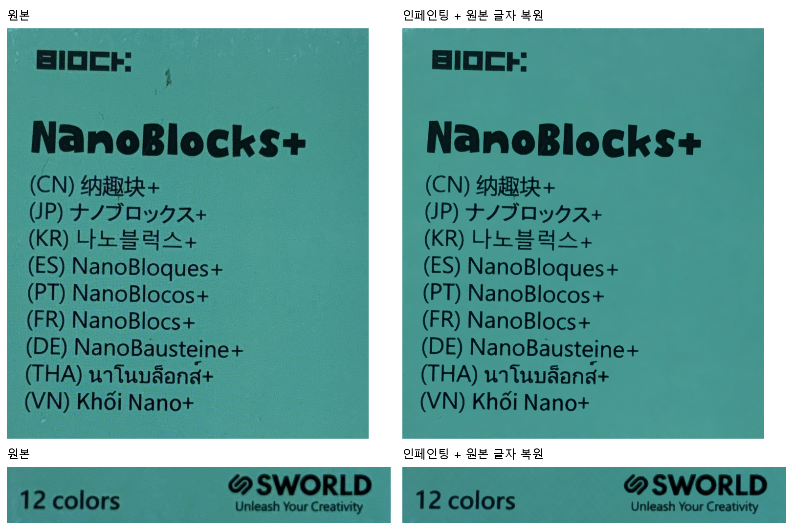
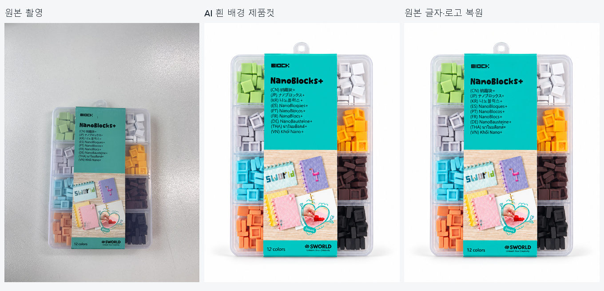
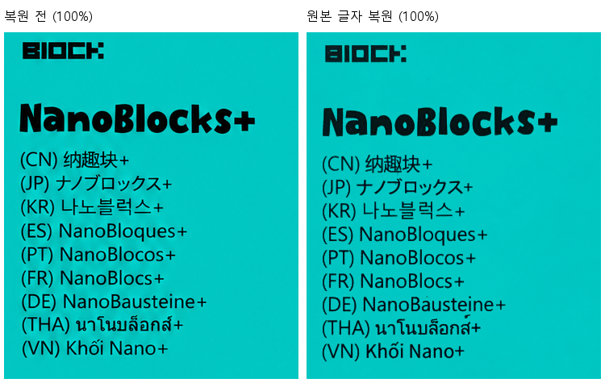

# product-text-inpaint

**텍스트·제품 사진의 자글거림 정리 전용 Codex 스킬**입니다. 한 번 설치하면 사진이 있는 폴더에서 `$product-text-inpaint`를 호출합니다. 실행 도구도 이 저장소에 포함돼 있습니다.

| 원하는 작업 | 방식 |
|---|---|
| 원본 글자·로고를 보존하며 인쇄면 정리 | 원본 잉크 추출 → 면만 AI 인페인팅 → 원본 잉크 합성 |
| 기존 결과에 원본 글자 가져오기 | 인쇄면 원근·크기 정렬 → 기존 글자 제거 → 원본 잉크 합성 |
| 사진 일부 또는 전체의 자글거림 정리 | 해당 영역을 AI로 편집하고 원본과 비교 |

## 실제 비교



위 비교는 원본 촬영 구도를 유지한 테스트입니다. 아래는 이미 만든 흰 배경 제품컷에 원본의 **상단 제품명·다국어 문구와 하단 글자·로고**를 가져온 예시입니다.





| 검증 항목 | 원본 구도 유지 | 기존 흰 배경 이미지에 복원 |
|---|---:|---:|
| 캔버스 | 3024×4032 | 1086×1448 |
| 글자 편집 영역 밖 변경 픽셀 | 0 | 0 |
| 준비한 불투명 잉크 내부 픽셀 | 46,130 | 11,366 |
| 합성 후 해당 픽셀 불일치 | 0 | 0 |
| 원근·크기 변환 | 없음 | 있음 |

검증은 박스 밖과 **준비된 잉크의 불투명 내부** 보존 검사입니다. 반투명 가장자리·가는 획·글자 내용·폰트·잔여 질감은 100% 확대 확인이 필요합니다. 흰 배경 이미지는 입력으로 사용한 AI 제품컷이며 케이스·블록·가운데 인쇄 사진은 이 스킬로 원본 복원한 영역이 아닙니다.

[최종 PNG](examples/product-text/final.png) · [입력·좌표·검증 샘플](examples/product-text/README.md)

## 설치

Git과 각자의 Codex 로그인이 필요합니다. Windows x64, Linux x64, macOS Apple Silicon용 로컬 setup을 제공합니다.

```sh
git clone https://github.com/csm-kr/product-text-inpaint.git
cd product-text-inpaint
```

Windows PowerShell:

```powershell
codex login
.\setup-local.cmd
.\.venv\Scripts\python.exe -X utf8 .\skills\product-text-inpaint\scripts\install.py
```

macOS / Linux:

```sh
codex login
./setup-local.sh
.venv/bin/python skills/product-text-inpaint/scripts/install.py
```

setup은 Python·Node·FFmpeg를 이 저장소 안에 준비합니다. 다른 비공개 저장소나 GitHub 로그인은 필요하지 않습니다. 설치 스크립트는 개인 Codex 스킬 폴더에 스킬과 도구 경로를 등록합니다. 기존 스킬이 있으면 덮어쓰지 않고 멈춥니다. 다른 설치 위치는 `install.py --dest <전체 스킬 폴더 경로>`로 지정합니다.

설치 후 **사진 폴더에서 새 Codex 세션을 열어 호출**하세요. 설치한 저장소 폴더는 실행 도구가 있는 곳이므로 유지해야 합니다. AI 호출에는 각자 로그인과 사용 가능한 지원 모델이 필요하며, 스킬이 모델을 확인합니다.

## 복사해서 쓰는 예시

### 원본 글자와 로고를 유지하면서 정리

```text
$product-text-inpaint
original.jpg의 글자 주변과 포장 인쇄면 자글거림을 정리해줘.
source와 base는 모두 original.jpg야.
글자·로고는 원본 잉크를 추출해 마지막에 다시 합성해줘.
원본 구도·사진 크기와 편집 영역 밖 픽셀을 유지해.
최종 PNG와 100% 비교, 검증 JSON을 output/text-clean에 저장해줘.
```

### 이미 만든 결과에 원본 글자 가져오기

```text
$product-text-inpaint
source는 original.jpg, base는 result.png야.
원본의 제품명·작은 설명·하단 로고를 결과의 원근에 맞춰 가져와줘.
기존 AI 글자는 지우고 인쇄면을 매끄럽게 정리한 뒤 원본 잉크만 합성해.
base 배경과 해상도는 유지하고 중앙 인쇄 사진은 편집하지 마.
```

### 사진 자체를 AI로 정리

```text
$product-text-inpaint
original.jpg 전체의 자글거림을 AI 편집으로 정리해줘.
제품 구조·색·구도·의미 있는 디테일과 이미지 크기를 유지해.
원본과 100% 비교하고 내용이나 글자 모양이 달라졌으면 알려줘.
별도 노이즈 제거 필터·샤프닝·업스케일은 추가하지 마.
```

사진 자체를 AI로 정리하는 모드는 픽셀을 다시 그립니다. 글자 보존이 우선이면 첫 번째 원본 잉크 복원 방식을 사용하세요. 원본의 흐림을 되돌리거나 자글거림이 완전히 사라진다고 보장하지 않습니다.

## 수동 실행과 오프라인 샘플

자세한 좌표·마스크·명령은 [워크플로](skills/product-text-inpaint/references/workflow.md)에 있습니다. 제공된 인페인팅 결과로 추출·합성을 재현하면 AI 사용량 없이 테스트할 수 있습니다.

```powershell
.\text-clean.cmd layers prepare --source examples\product-text\source.png --base examples\product-text\base.png --config examples\product-text\regions-studio.json --out out\sample-prepare
.\text-clean.cmd layers composite --prepared out\sample-prepare --clean-base examples\product-text\clean-base.png --out out\sample-final
.\text-clean.cmd layers verify --prepared out\sample-prepare --image out\sample-final\final.png
```

실제 AI 정리는 현재 계정이 지원하는 모델을 지정해 실행합니다.

```powershell
.\text-clean.cmd restore --prepared out\sample-prepare --out out\restored --model supported-model-slug
.\text-clean.cmd cleanup --image original.jpg --out out\photo-clean --model supported-model-slug
```

`supported-model-slug`는 실제 지원 모델로 바꿉니다. 2026-10-14 이미지 테스트에서는 `gpt-6.1-sol`로 성공했으며 현재 지원 여부는 계정에서 확인합니다. `cleanup --box`로 일부 영역만 지정할 수 있습니다. Windows에서 쉼표 좌표를 `.cmd`에 직접 넘길 때는 [워크플로의 `--%` 예시](skills/product-text-inpaint/references/workflow.md)를 따릅니다.

## 확인과 라이선스

`text-clean doctor`는 로그인·로컬 런타임을 점검하며 `test-local`은 AI 호출 없이 기능 검사를 실행합니다. AI 경로는 지원되지 않는 private backend라서 원격 변경이나 계정 조건으로 실패할 수 있습니다. 추출·합성·검증은 로컬에서 실행됩니다.

2026-10-15 Windows x64에서 새 폴더의 로컬 setup, **기능 검사 163개**, 제공 샘플 추출·합성·검증, 실제 사진 작업 폴더에서 설치된 스킬 호출, AI dry-run을 확인했습니다. 비교 이미지의 원격 AI 생성은 앞서 완료한 이미지 테스트 결과이며 이번 독립 배포 검증에서 새로 생성하지 않았습니다.

코드·스킬·문서는 [MIT 라이선스](LICENSE)입니다. 필요한 인페인팅 코드와 런타임만 분리했으며 원래 출처와 고지는 [PROVENANCE.md](PROVENANCE.md)에 남겼습니다. 이미지·제품 상표는 [NOTICE.md](NOTICE.md)의 별도 범위를 따릅니다.
